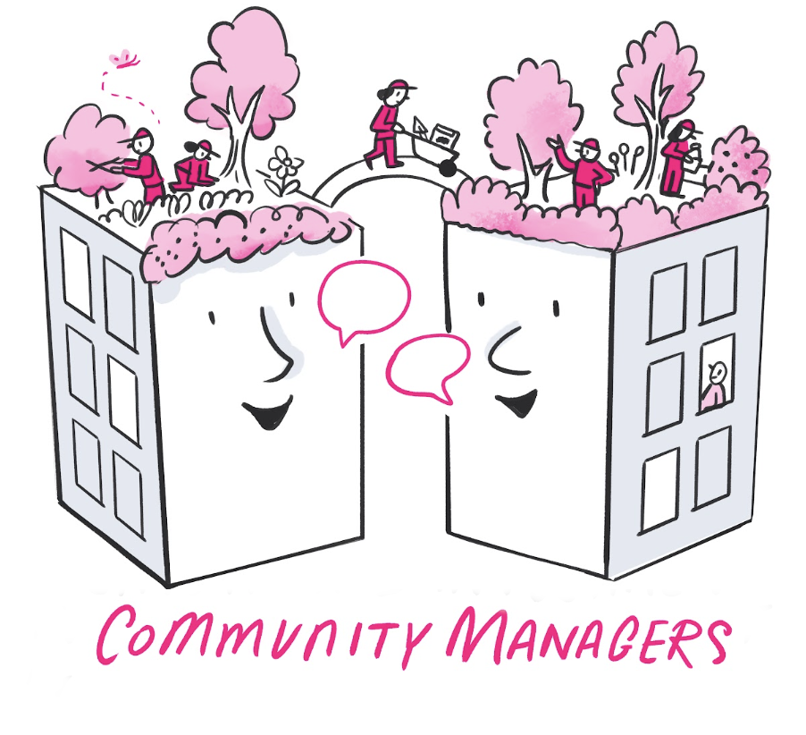

# Open Research Community Management

This handbook preserves resources and practices developed by the Research Community Managers (RCMs) at The Alan Turing Institute. RCMs enable open, inclusive, and reproducible research by connecting people, projects, and shared knowledge.

> **Project status:** This is a historic resource. The repository and handbook are no longer actively maintained; details about people, projects, and meeting schedules may no longer be current.

## Explore the handbook

- Learn about the [background](background.md), [goals](goals.md), and [values and principles](values-principles.md) that informed the team's work.
- Meet the [team](team/about-the-team.md), review its [onboarding guidance](onboarding.md), and find the historic [meeting format](meetings.md).
- Read selected [briefing notes](briefing-notes.md) and discover how the team contributed to [*The Turing Way*](rcm-ttw.md).

## Context

The RCM team worked across Turing programmes, projects, and external collaborations. Its members made implicit knowledge explicit, supported meaningful participation, and developed processes and resources that could be reused across research communities.

Many RCMs also contributed to [*The Turing Way*](https://the-turing-way.netlify.app/welcome), an open, community-driven guide to data science. People seeking active community-management resources are encouraged to explore and contribute there.

The source and contribution guidance are available in the [GitHub repository](https://github.com/alan-turing-institute/open-research-community-management). All participants are expected to follow the [Code of Conduct](https://github.com/alan-turing-institute/open-research-community-management/blob/main/CODE_OF_CONDUCT.md).
